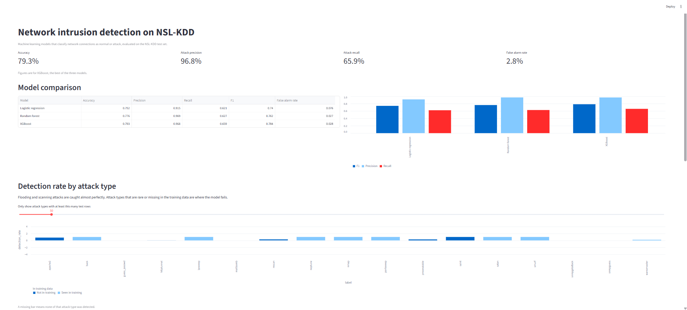
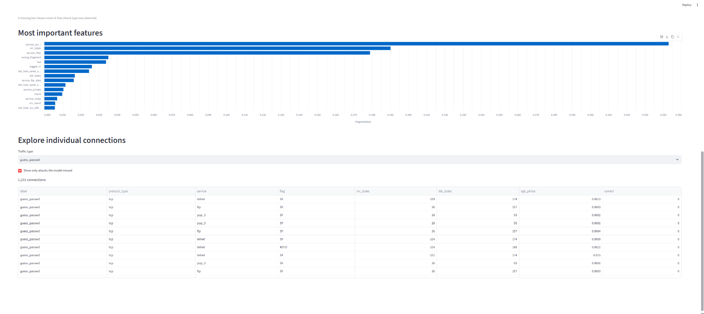
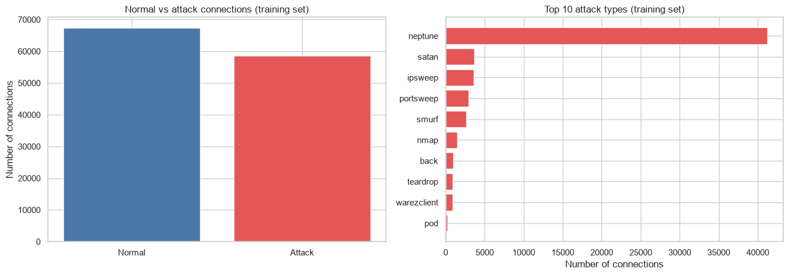
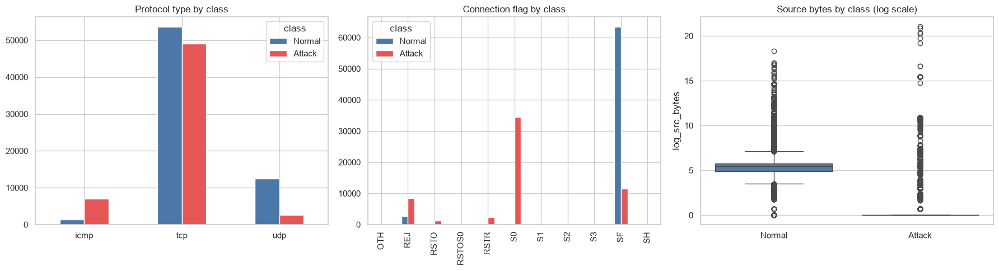
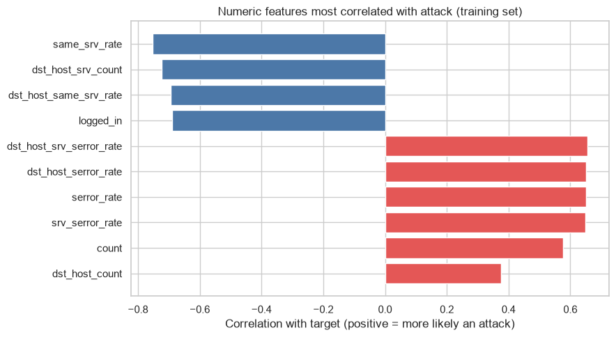

By Uganraj Sugumaran | Diploma in Information Technology Specialisation in Data Informatics | 2026
[LinkedIn] www.linkedin.com/in/uganraj-sugumaran-312984369
# Network intrusion detection on NSL-KDD

A machine learning project that classifies network connections as normal or attack, with a Streamlit dashboard for exploring the results. Built as a diploma-level data analytics portfolio project.





## Problem

Network traffic produces far more log data than anyone can check by hand, and rule-based systems miss new attack patterns. This project asks whether a machine learning model can tell normal traffic from attacks well enough to help an analyst, and which features give attacks away.

## Data

The NSL-KDD dataset, from the Canadian Institute for Cybersecurity at the University of New Brunswick. It has 125,973 training connections and 22,544 test connections, each described by 41 features. The official test set deliberately contains attack types that do not appear in the training set.

Source: Tavallaee, Bagheri, Lu and Ghorbani, "A detailed analysis of the KDD CUP 99 data set", 2009.

## Method

1. Checked the data for missing values, duplicates and constant columns. It was already clean, so only `num_outbound_cmds` (constant) and `difficulty` (a score added by the dataset's authors) were dropped.
2. Grouped all attack types into one class, giving a binary target (normal or attack). The classes were close to balanced (53.5% normal, 46.5% attack in training), so no resampling was needed.
3. One-hot encoded the three categorical columns (protocol, service, flag).
4. Trained three models: logistic regression (baseline, with log-transformed and scaled features), random forest and XGBoost.
5. Evaluated on the official test set using precision, recall, F1 and false alarm rate, then broke the results down by attack type.

## Results

Precision, recall and F1 are for the attack class.

| Model | Accuracy | Precision | Recall | F1 | False alarm rate |
|---|---|---|---|---|---|
| Logistic regression | 0.752 | 0.915 | 0.621 | 0.740 | 0.076 |
| Random forest | 0.776 | 0.969 | 0.627 | 0.762 | 0.027 |
| XGBoost | 0.793 | 0.968 | 0.659 | 0.784 | 0.028 |

## Findings

- XGBoost performed best, but the gap between models is modest. The tree models mainly cut false alarms, from 7.6% to under 3%.
- All three models miss about a third of attacks. Flooding and scanning attacks (neptune, smurf, satan, the sweeps) are detected almost perfectly.
- The missed attacks fall into two groups. Attack types absent from the training data were detected 38% of the time, against 77% for types the model had seen. Password-guessing and file-access attacks (guess_passwd, warezmaster) were also missed despite appearing in training, but with only 53 and 20 training examples against more than 2,000 in the test set.
- Three features account for about 71% of XGBoost's feature importance: the ICMP echo-reply service, source bytes and the HTTP service.

## Figures



*Figure 1: Normal vs attack connections in the training set (left) and the ten most common attack types (right). The classes are close to balanced, but neptune makes up about 70% of all attacks.*



*Figure 2: ICMP traffic is mostly attacks, the S0 flag is almost entirely attacks, and most attack connections send no data (source bytes on a log scale).*



*Figure 3: Numeric features most correlated with attack. SYN error rates and connection counts are higher in attacks, while same-service rates and successful logins are lower.*

## Limitations

- The model is evaluated on one dataset whose attack types are decades old, so the results say little about modern traffic.
- Reliance on specific service names suggests the model partly learns features of this dataset.
- Rare and unseen attack types are the weak point, and a real deployment would need regular retraining.
- Only binary classification was attempted. Multiclass classification would be a natural next step.

## Files

| File | Contents |
|---|---|
| `nids_analysis.ipynb` | Full analysis, from cleaning to evaluation |
| `app.py` | Streamlit dashboard |
| `train_clean.csv`, `test_clean.csv` | Cleaned data |
| `test_predictions.csv`, `model_results.csv`, `detection_by_attack_type.csv`, `feature_importance.csv` | Model outputs used by the dashboard |
| `requirements.txt` | Python packages |
| `images/` | Charts and dashboard screenshots |

## How to run

```
pip install -r requirements.txt
jupyter lab
python -m streamlit run app.py
```

Open `nids_analysis.ipynb` in Jupyter to see the analysis. The dashboard reads the CSV files in the same folder.
